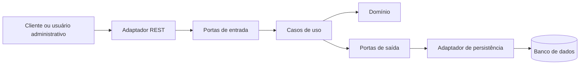

# RFC-001 - Adoção de arquitetura hexagonal no monólito

- **Data:** 26/11/2026
- **Status:** Aberta para comentários
- **Responsável:** Ítalo Martins de Deus

## Resumo

Propõe-se a adoção de uma arquitetura hexagonal para o back-end monolítico do sistema da oficina.

A arquitetura deve manter as regras de negócio isoladas de frameworks, banco de dados e interfaces externas, facilitando testes, manutenção e evolução do sistema.

## Problema

O sistema precisa atender a diferentes fluxos de negócio, como:

- Criação e acompanhamento de ordens de serviço;
- Geração e aprovação de orçamentos;
- Cadastro de clientes, veículos, serviços e peças;
- Controle de estoque;
- Autenticação das APIs administrativas.

Como o projeto utiliza DDD e possui regras importantes de negócio, concentrar responsabilidades em controllers, services e repositories pode aumentar o acoplamento com frameworks e dificultar os testes.

Também existe o risco de que regras como transições de status, validação de dados e controle de estoque sejam espalhadas pela aplicação.

## Proposta técnica

Adotar uma arquitetura hexagonal dentro de um único monólito.

A solução será organizada em três níveis principais:

1. **Domínio:** regras de negócio, entidades, objetos de valor, agregados e eventos de domínio.
2. **Aplicação:** casos de uso, orquestração das operações e definição das portas.
3. **Adaptadores e infraestrutura:** API REST, autenticação, persistência, banco de dados e documentação Swagger.

As dependências devem apontar para o núcleo da aplicação. O domínio não deve depender de HTTP, ORM, banco de dados ou framework.



### Organização inicial

```text
src/
├── domain/
│   ├── entities/
│   ├── value-objects/
│   ├── aggregates/
│   ├── domain-services/
│   └── domain-events/
├── application/
│   ├── use-cases/
│   └── ports/
│       ├── in/
│       └── out/
├── adapters/
│   ├── in/
│   │   ├── rest/
│   │   └── authentication/
│   └── out/
│       └── persistence/
└── config/
```

Os nomes dos diretórios são apenas uma sugestão e podem ser adaptados à linguagem e ao framework escolhidos.

### Domínio

O domínio deve concentrar as regras relacionadas a:

- Ordem de serviço;
- Status e transições da ordem de serviço;
- Serviços executados;
- Peças e insumos;
- Orçamento;
- Aprovação ou rejeição do orçamento;
- Clientes e veículos;
- Controle de estoque;
- Validação de CPF, CNPJ e placa de veículo.

A `OrdemServico` é uma candidata a agregado principal, contendo os itens de serviço, peças, orçamento e status da execução. Essa definição deverá ser validada durante o Event Storming.

### Camada de aplicação

A camada de aplicação deve expor casos de uso, por exemplo:

- `CriarOrdemServico`;
- `AdicionarItensNaOrdemServico`;
- `GerarOrcamento`;
- `AprovarOrcamento`;
- `RejeitarOrcamento`;
- `AlterarStatusDaOrdemServico`;
- `ConsultarOrdemServico`;
- `ControlarEstoque`;
- `CadastrarCliente`;
- `CadastrarVeiculo`.

Os casos de uso serão responsáveis por coordenar as operações, controlar as transações e utilizar as portas de saída necessárias.

### Portas de entrada

As portas de entrada representam as operações que a aplicação oferece para os adaptadores externos.

Exemplo:

```text
CriarOrdemServicoInputPort
AprovarOrcamentoInputPort
ConsultarOrdemServicoInputPort
```

Os controllers REST devem apenas validar o formato da requisição, chamar as portas de entrada e retornar a resposta HTTP adequada.

### Portas de saída

As portas de saída abstraem recursos externos usados pelos casos de uso.

Exemplos:

```text
OrdemServicoRepository
ClienteRepository
VeiculoRepository
EstoqueRepository
TransactionManager
TokenProvider
```

As implementações dessas interfaces ficarão nos adaptadores de infraestrutura.

### Adaptadores

Os adaptadores de entrada serão responsáveis por:

- Expor as APIs REST;
- Autenticar usuários administrativos com JWT;
- Validar os dados de entrada da requisição;
- Documentar os endpoints com Swagger ou OpenAPI.

Os adaptadores de saída serão responsáveis por:

- Persistir dados no banco escolhido;
- Implementar os repositories;
- Mapear entidades de domínio para modelos de persistência;
- Configurar transações;
- Integrar serviços externos, caso sejam necessários.

## Impacto esperado

### Benefícios

- Isolamento das regras de negócio;
- Maior facilidade para testar o domínio sem banco ou framework;
- Redução do acoplamento com a tecnologia de persistência;
- Possibilidade de trocar o adaptador REST ou o banco com menor impacto;
- Melhor organização dos casos de uso;
- Maior alinhamento entre DDD e implementação;
- Facilidade para evoluir o monólito sem antecipar uma divisão em microserviços.

### Custos e limitações

- Maior quantidade de interfaces, mapeamentos e classes;
- Necessidade de disciplina para preservar a direção das dependências;
- Possível aumento de código para um MVP pequeno;
- A arquitetura não elimina a necessidade de boas decisões de modelagem e testes.

### Restrições

- A aplicação continuará sendo um único back-end monolítico;
- Não será criada uma arquitetura de microserviços nesta fase;
- O sistema utilizará uma implantação única e, inicialmente, um banco principal.

## Alternativas consideradas

### Monólito tradicional em camadas

É uma alternativa simples e compatível com o escopo do desafio. Porém, pode permitir que regras de negócio fiquem espalhadas entre controllers, services e repositories, aumentando o acoplamento com frameworks e infraestrutura.

Foi considerada, mas a arquitetura hexagonal oferece limites mais explícitos entre o domínio e os recursos externos.

### Microserviços

Não são recomendados para o MVP, pois aumentariam a complexidade operacional, de comunicação, observabilidade, deploy e testes.

Além disso, o desafio exige um back-end monolítico.

## Critérios de validação

A proposta será considerada adequada se:

- O domínio puder ser testado sem subir o banco de dados;
- Os casos de uso puderem utilizar repositories em memória nos testes unitários;
- O domínio não importar classes de HTTP, ORM ou framework;
- Os fluxos principais forem testados por testes unitários e de integração;
- A criação e o acompanhamento da ordem de serviço funcionarem pela API REST;
- As transições de status forem controladas por regras centralizadas;
- A autenticação JWT estiver restrita às APIs administrativas;
- A cobertura mínima de 80% for atingida nos domínios críticos.

## Pontos em aberto

- Identificação final dos bounded contexts após o Event Storming;
- Definição dos agregados e limites da `OrdemServico`;
- Matriz oficial de transições de status;
- Regras para aprovação ou rejeição de orçamentos;
- Estratégia de autorização dos diferentes perfis de usuário;
- Necessidade de notificações externas;
- Estratégia de auditoria das alterações da ordem de serviço;
- Definição dos limites transacionais envolvendo ordem de serviço e estoque.

## Próximos passos

1. Revisar esta RFC com o grupo.
2. Validar os limites do domínio a partir do Event Storming.
3. Ajustar a proposta conforme os comentários.
4. Formalizar a decisão em uma ADR caso a proposta seja aprovada.
5. Implementar a estrutura inicial do monólito.
6. Validar a arquitetura com testes dos principais casos de uso.
